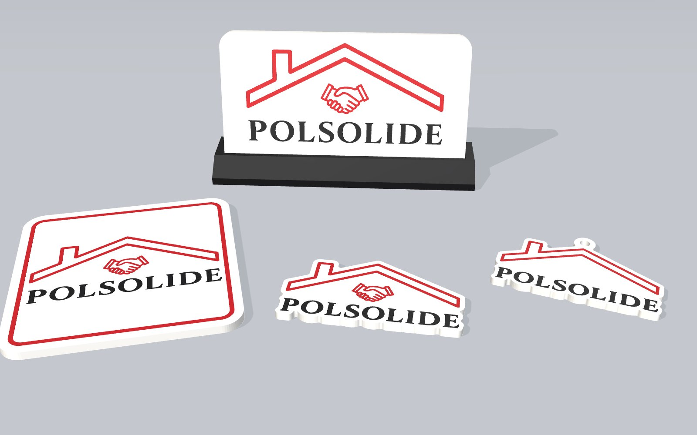

# POLSOLIDE – gadżety 3D

Cztery gadżety z logo POLSOLIDE do druku 3D w trzech kolorach (biały, czerwony, czarny):
brelok do kluczy, podkładka pod kubek, magnes na lodówkę i tabliczka na biurko ze stopką.

## Podgląd 3D

`index.html` pokazuje wszystkie modele jeden pod drugim – każdy można obracać i przybliżać.
Numerowane punkty (hotspoty) na modelach pokazują szczegóły: otwór na kółko, naroża R10, gniazda na magnesy, rowek w stopce itd. Kliknięcie punktu obraca kamerę w to miejsce i wyświetla opis pod modelem.

Publikacja na GitHub Pages:
1. Wrzuć zawartość tego folderu do repozytorium (np. `polsolide-gadzety`).
2. **Settings → Pages → Build and deployment → Source: Deploy from a branch**, gałąź `main`, folder `/ (root)`.
3. Po minucie strona będzie pod adresem `https://<konto>.github.io/<repozytorium>/`.

Strona nie potrzebuje serwera ani instalacji – biblioteka do 3D (`lib/model-viewer.min.js`) jest w repozytorium.
Otwarta lokalnie z dysku (`file://`) modele się nie wczytają; podejrzyj ją przez GitHub Pages albo `python -m http.server`.

## Struktura

| Folder | Zawartość |
|---|---|
| `models/` | modele GLB w kolorach (do podglądu, AR, prezentacji) |
| `stl/` | pliki do druku – osobny STL na każdy kolor, w orientacji do druku; instrukcja w `stl/CZYTAJ.txt` |
| `img/` | rendery zestawu i poszczególnych gadżetów |
| `lib/` | Google `<model-viewer>` 3.4.0 (licencja Apache 2.0, `lib/model-viewer.LICENSE`) |

## Druk

- Bambu Lab A1 + AMS Lite, PLA, warstwa 0,2 mm, płyta teksturowana PEI.
- Logo wtopione w lico na 0,6 mm – lico drukuje się na stole, zmiany kolorów tylko w 3 pierwszych warstwach.
- W Bambu Studio zaznacz wszystkie STL jednego gadżetu naraz → „wczytaj jako jeden obiekt z wieloma częściami” → przypisz filamenty.

| Gadżet | Wymiar | Uwagi |
|---|---|---|
| Brelok | 74 × 47 × 3,5 mm | otwór Ø 4,6 mm na kółko |
| Podkładka | 100 × 100 × 4 mm | pod bardzo gorące kubki lepiej całość z PETG |
| Magnes | 80 × 43 × 3,6 mm | 2 gniazda na magnesy 10 × 2 mm, wklejane po druku |
| Tabliczka | 130 × 74 × 4 mm + stopka 140 × 34 × 12 mm | stopka drukowana osobno, jednym kolorem |
